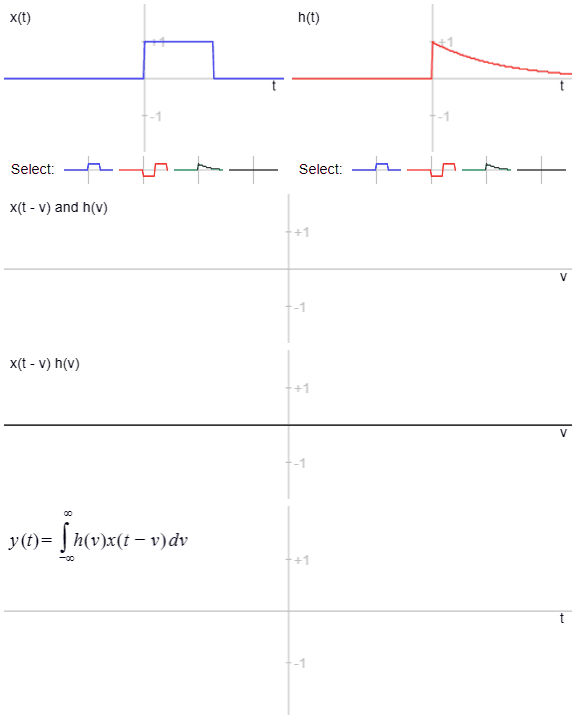
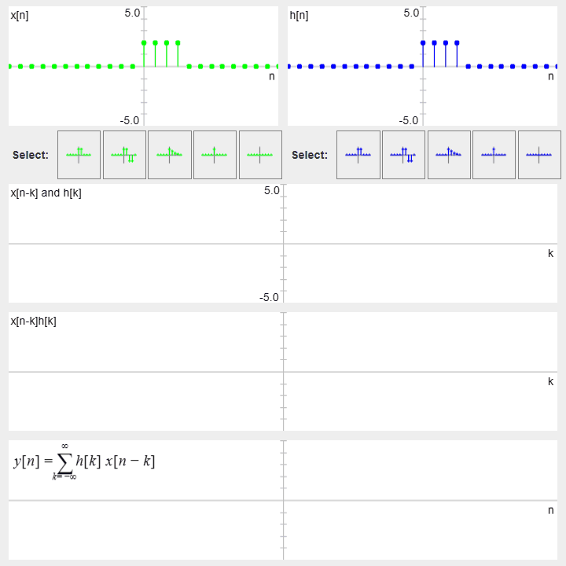

# The Joy of Convolution — browser port (work in progress)

A browser port of *The Joy of Convolution*, the Java applet by **Steven Crutchfield**
(Johns Hopkins University; continuous time Fall 1996, discrete time Summer 1997, updated by
**Michael Ross**, Fall 2001), from the Johns Hopkins *Signals, Systems, and Control
Demonstrations* directed by **Wilson J. Rugh**. Full credits are [below](#credits).

## Run it in your browser

**[▶ Continuous time: The Joy of Convolution](https://electricyoshi.github.io/Joy-of-Convolution-Sim/joy_of_convolution.html)**

**[▶ Discrete time: Joy of Convolution (Discrete Time)](https://electricyoshi.github.io/Joy-of-Convolution-Sim/joy_of_convolution_dt.html)**

Nothing to download or install. Works in a current Chrome, Edge, Firefox or Safari.

> **Work in progress: not yet for classroom use.** The original applets and related material
> are © 1995–2003 Johns Hopkins University and Wilson J. Rugh, all rights reserved. This port is
> a derivative work made for a Seattle Pacific University course. **Written permission from the
> original authors is being sought and has not been granted.** Please do not use it with
> students yet, and do not treat it as endorsed by or affiliated with Johns Hopkins University,
> Steven Crutchfield, Michael Ross, or Wilson J. Rugh.

## Demo

Pick a signal for x and for h with the **Select** buttons, then press and drag in the middle
panel. As you drag, the flipped copy of x slides past h, the panel below shows their product,
and the area under that product is traced out as the output y.





## Things to try

- **Draw your own signal:** press and drag inside x or h to sketch any shape, then convolve it.
- **pulse ∗ pulse** (continuous) or **Square pulse ∗ Square pulse** (discrete): why is the
  result a triangle, and why does its peak sit where the two pulses overlap completely?
- **pulse ∗ decay:** the output rises while the pulse slides onto the exponential, then decays.
  Compare it to charging and discharging an RC circuit.
- **Unit Impulse** for x (discrete): the output is a copy of h. That is why h is called the
  impulse response.
- Each page has the original's **Welcome!**, **Exercises** and **Quiz** sections below the applet.

## Offline copy

Each page is one self-contained file. [Download the ZIP](https://github.com/electricyoshi/Joy-of-Convolution-Sim/archive/refs/heads/main.zip),
unzip it, and double-click `joy_of_convolution.html` or `joy_of_convolution_dt.html`. Clicking
the file on GitHub only shows its source code; use the links above instead.

## Status (development)

- Both ports are faithful first ports. Their arithmetic matches the original applets exactly
  in scripted tests. What differs on purpose is listed in [QUIRKS.md](QUIRKS.md).
- Hands-on checks ([CHECKLIST.md](CHECKLIST.md)) passed, 2026-11-18. The transcripts on the pages
  are still to be checked against the original narration.

Tests (Python 3, standard library only; the browser tests use Chrome or Edge if installed):

```
py -m unittest discover -s tests -v
```

The demo GIFs are rendered by the pages themselves: `py tools/make_demo.py` (needs Pillow).

## Credits

The original applets are the work of **Steven Crutchfield** (continuous time, Fall 1996;
discrete time, Summer 1997), with the discrete-time update by **Michael Ross** (Fall 2001),
created for the Johns Hopkins University *Signals, Systems, and Control Demonstrations*
project directed by **Wilson J. Rugh** (1994–2003). Narration by **Cherie Weinert**. Site page
design by **Mark Nesky**. Supported by the National Science Foundation, the Kenan Fund, the
Johns Hopkins Center for Educational Resources, and the E. J. Schaefer Chair. Premier
Engineering Courseware of 2001.

Original site: https://pages.jh.edu/signals/

This browser port: electricyoshi, for a Seattle Pacific University course.
