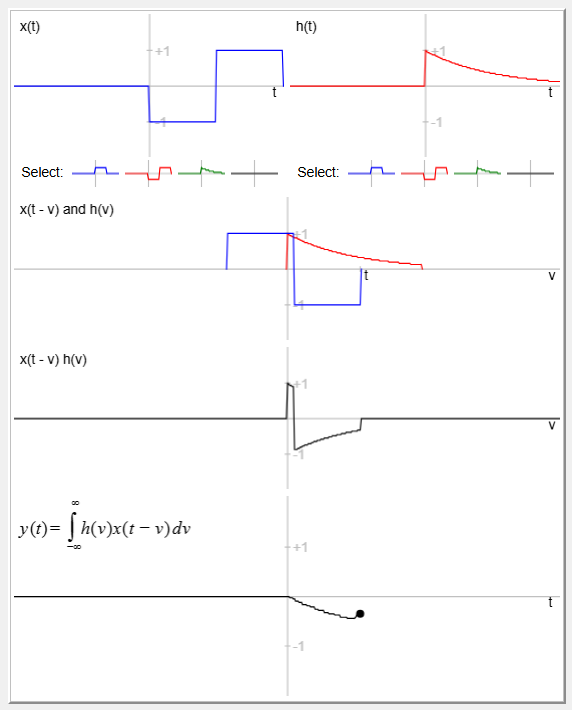

# The Joy of Convolution — browser port (work in progress)

> **Work in progress — not yet for classroom use.**
>
> This is a browser port of *The Joy of Convolution*, the Java applet by **Steven Crutchfield**
> (Johns Hopkins University, Fall 1996; discrete-time version Summer 1997, updated by
> **Michael Ross**, Fall 2001), part of the Johns Hopkins *Signals, Systems, and Control
> Demonstrations* project directed by **Wilson J. Rugh**.
>
> The original applets and related material are © 1995–2003 Johns Hopkins University and
> Wilson J. Rugh, all rights reserved. This port is a derivative work made for a Seattle
> Pacific University course. **Written permission from the original authors is being sought
> and has not been granted.** While the port is under development this repository is for
> development only: please do not use it with students, and do not treat it as endorsed by or
> affiliated with Johns Hopkins University, Steven Crutchfield, Michael Ross, or Wilson J. Rugh.
> Full credits are below.

## Status

- **Continuous time:** a first faithful port is done (`joy_of_convolution.html`) and is
  waiting for hands-on checks ([CHECKLIST.md](CHECKLIST.md)). Its arithmetic matches the original applet's
  bit for bit in scripted tests; what differs on purpose is listed in [QUIRKS.md](QUIRKS.md).
- **Discrete time:** not started.



To try it during development: download or clone the repository and double-click
`joy_of_convolution.html`. It is a single file with nothing to install and no network access.

Tests (Python 3, standard library only; the browser tests use Chrome or Edge if installed):

```
py -m unittest discover -s tests -v
```

## Credits

The original applets are the work of **Steven Crutchfield** (continuous time, Fall 1996;
discrete time, Summer 1997), with the discrete-time update by **Michael Ross** (Fall 2001),
created for the Johns Hopkins University *Signals, Systems, and Control Demonstrations*
project directed by **Wilson J. Rugh** (1994–2003). Narration by **Cherie Weinert**. Site page
design by **Mark Nesky**. Supported by the National Science Foundation, the Kenan Fund, the
Johns Hopkins Center for Educational Resources, and the E. J. Schaefer Chair. Premier
Engineering Courseware of 2001.

Original site: https://pages.jh.edu/signals/

This browser port: electricyoshi, for a Seattle Pacific University course.
